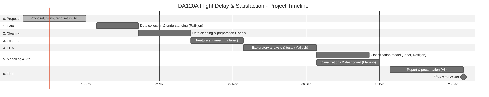

# Project Execution Plan

**Timeline:** 9 November – 21 December 2026 (6 weeks). Dates will be adjusted to the official course deadline.

## Phases
| # | Phase | Key tasks | Deliverable | Owner | Dates |
|---|---|---|---|---|---|
| 0 | Proposal & setup | Topic, dataset selection, repo structure, plans | Approved proposal, structured repo | All | 09–15 Nov |
| 1 | Data collection & understanding | Download data, merge train/test, verify columns | Raw dataset + data dictionary | Rafikjon | 16–19 Nov |
| 2 | Data cleaning & preparation | Missing arrival delays (393 rows), outliers, "0 = not applicable" ratings, type fixes, duplicates | Cleaned dataset (`data/processed/`) | Taner | 20–24 Nov |
| 3 | Feature engineering | Delay categories, delayed flag, delay recovered, avg service score, encoding | Analysis-ready table | Taner | 25–29 Nov |
| 4 | Exploratory data analysis | Distributions, satisfaction by delay group, segment comparisons, chi-square / t-tests | EDA notebook | Mallesh | 30 Nov – 06 Dec |
| 5a | Modelling | Logistic regression & random forest, feature importance (delays vs. service) | Model notebook + results | Taner, Rafikjon | 07–11 Dec |
| 5b | Visualisation | Final charts and dashboard | Charts / dashboard | Mallesh | 07–12 Dec |
| 6 | Report & presentation | Findings, recommendations, slides | Final report + presentation | All | 14–20 Dec |
| ★ | Final submission | — | All deliverables on GitHub | Rafikjon | 21 Dec |

## Milestones
| Milestone | Date |
|---|---|
| M1 – Proposal submitted | 15 Nov |
| M2 – Clean, feature-engineered dataset ready | 29 Nov |
| M3 – EDA complete | 06 Dec |
| M4 – Model and visuals complete | 12 Dec |
| M5 – Final submission | 21 Dec |

## Communication
- Weekly check-in on MS Teams (instructor @mentioned on questions).
- Every completed task is logged in the README project log (Date | Update | Issue | Solution | Owner).

## Gantt Chart

